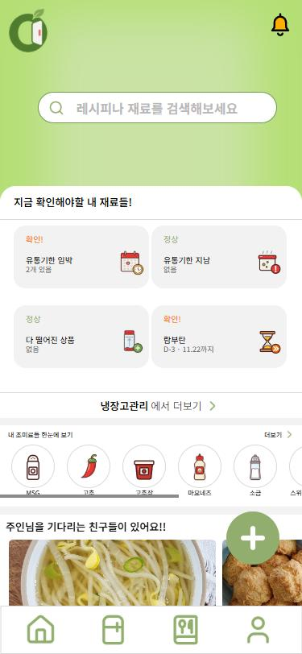
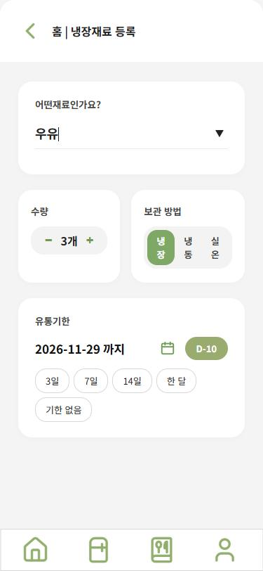
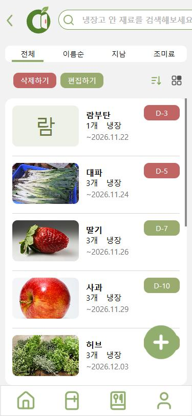
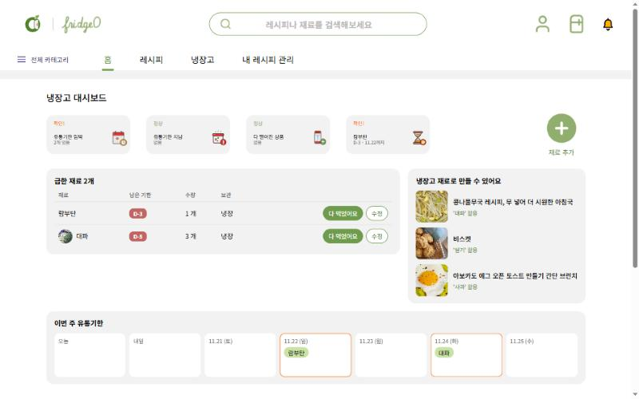
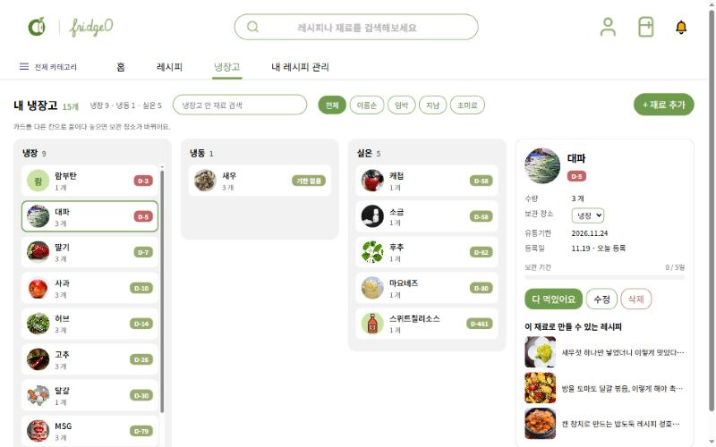
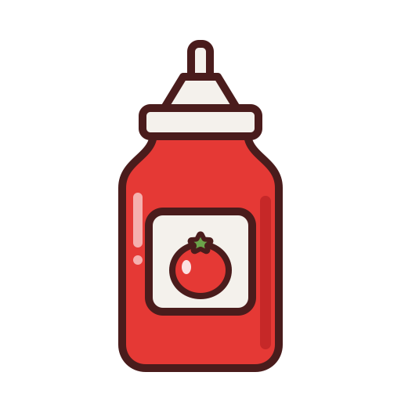
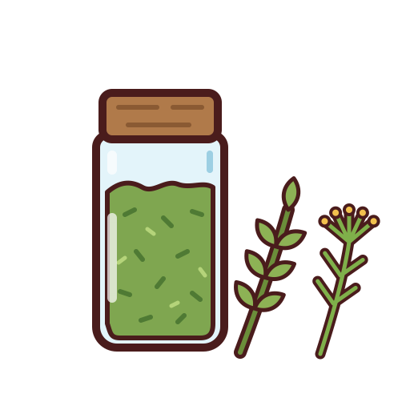

  
   
  

<h3 align="center">내 냉장고 속 재료를 관리하고, 남은 재료로 오늘의 요리를 고르는 서비스</h3>

  <a href="https://fridgeo.pages.dev">🔗 서비스 바로가기 (fridgeo.pages.dev)</a>
   
  2026.11.04 – 11.20 (17일) · 팀원 4명 · 모바일 · 데스크탑 웹

---

##  팀원

| 황건영 | 성시원 | 김미래 | 홍순법 |
| :---: | :---: | :---: | :---: |
| **서버 · 데이터 · 배포** | **프로젝트 기반 · 냉장고** | **마이페이지 · 재료 입력** | **레시피 · 리뷰** |
| 메인 화면, 알림, 하단 메뉴 로그인 · 가입 · 문자 인증, 북마크 모든 페이지 DB 연동, DB 구축 데스크탑 화면 전체 서버 전환, 자동 배포 | React + Vite 기본 구조 냉장고 박스형 목록과 기한 표시 임박순 정렬 · 편집 · 삭제 | 마이페이지 · 상단 헤더 재료 등록 · 편집 달력 프로필 사진 | 레시피 목록과 분류 아이콘 레시피 상세 페이지 리뷰 작성 · 편집 · 삭제 |

> 화면은 기능별로 나눠 만들고, 11월 11일부터 서버 연동으로 하나의 데이터에 묶었습니다.

---

##  프로젝트 개요

| 항목 | 내용 |
| --- | --- |
| **서비스명** | fridgeO (프릿지오) |
| **한 줄 소개** | 내 냉장고 속 재료를 관리하고, 보유 재료로 요리를 선택하도록 돕는 서비스 |
| **기획 목적** | 식재료 방치를 줄이고, 재료 확인과 메뉴 선택에 드는 수고를 줄인다 |
| **핵심 가치** | 재료 현황 파악 · 기한 관리 · 보유 재료 활용 |
| **주요 대상** | 1인 가구 · 자취생, 집에서 요리하는 사용자 |
| **서비스 형태** | 모바일 중심 웹 서비스 + 데스크탑 화면 (폭 1024px 기준으로 전환) |

### 핵심 이용 흐름

  <b>① 재료 등록</b> &nbsp;➜&nbsp; <b>② 상태 확인</b> &nbsp;➜&nbsp; <b>③ 요리 선택</b> &nbsp;➜&nbsp; <b>④ 재료 활용</b>

재료를 기록하는 데서 끝나지 않고, **남은 재료를 오늘의 요리로 바로 연결**하는 것이 목표입니다.

---

## 화면 미리보기

### 모바일

| 홈 대시보드 | 재료 등록 | 내 냉장고 | 레시피 준비물 |
| :---: | :---: | :---: | :---: |
|  |  |  |  |
| 임박 · 지남 · 다 떨어짐 · 가장 급한 재료를 4칸 카드로 요약 | 이름만 입력하면 기한을 자동 제안 (우유 → D-10) | 기한 임박순 정렬 5일 이하는 빨간 D-day 배지 | 가진 재료는 자동 체크 (3/10) 없는 재료는 한 번에 쇼핑 검색 |

### 데스크탑

| 냉장고 대시보드 | 3칸 냉장고 |
| :---: | :---: |
|  |  |
| 급한 재료 표 · 이번 주 유통기한 달력 · 냉장고 재료로 만들 수 있는 레시피 | 냉장 · 냉동 · 실온을 나란히, 카드를 끌어 보관 장소 변경 재료를 누르면 상세와 관련 레시피 |

---

## 해결하려는 문제

| 사용자 문제 (가설) | fridgeO의 해결 방향 |
| --- | --- |
| 어떤 재료가 남아 있는지 기억하기 어렵다 | **냉장고 재료 목록** — 수량 · 단위 · 실온/냉장/냉동 보관 장소 |
| 재료의 기한을 자주 놓친다 | **임박 · 지남 상태와 알림** — D-day 배지, 5일 이하 남으면 알림 |
| 재료가 있어도 무엇을 만들지 고민된다 | **보유 재료 기반 레시피 추천** — 내 재료 · 기한 · 별점을 함께 반영 |
| 필요한 재료가 있는지 다시 확인해야 한다 | **준비물 보유 여부 표시** — 없는 재료는 바로 쿠팡 검색으로 연결 |
| 마음에 든 레시피를 다시 찾기 어렵다 | **북마크 · 최근 본 레시피 · 리뷰** |

대표 사용자: *장을 본 뒤 남은 재료를 자주 잊고, 퇴근 후 메뉴 고민이 많은 자취생*

---

## 주요 기능

| 메뉴 | 기능 |
| --- | --- |
|  **홈** | 재료 상태 카드, 내 조미료, 냉장고 재료로 만들 수 있는 추천 레시피 |
|  **냉장고** | 재료 검색 · 정렬 · 필터(전체 · 이름순 · 지남 · 조미료), 수정 · 삭제, 다 떨어진 재료 기록 |
|  **재료 등록** | 재료명 자동완성, 수량 · 보관 장소, 기한 자동 제안과 빠른 선택(3일 ~ 한 달 · 기한 없음) |
|  **레시피** | 분류별 목록, 통합 검색, 상세(준비물 보유 체크 · 단계별 사진), 레시피 작성 · 수정 |
|  **참여** | 별점 · 리뷰, 북마크, 작성자 팔로우 |
|  **마이페이지** | 프로필, 내가 쓴 레시피, 북마크, 최근 본 레시피, 알림 설정, 개인정보 관리 |
|  **계정** | 회원가입 · 로그인 · 휴대폰 문자 인증, 계정 찾기 |

### 서비스 포인트 — 입력은 줄이고, 화면은 내 냉장고 데이터로 채웁니다

| 기능 | 이전 | 개선 후 |
| --- | --- | --- |
| 기한 기본값 | 어떤 재료든 오늘 + 7일 | 재료 사전의 보관 일수로 계산 |
| 레시피 준비물 | 고정 데모 목록이라 누구에게나 같은 체크 | 내 냉장고 보유 여부로 체크 |
| 다 떨어진 재료 | 수량 0은 저장할 수 없어 지워야 함 | 0 = 다 떨어짐으로 남기고 홈에 모아 표시 |
| 조미료 | 냉장고와 상관없이 항상 같은 6개 | 내 냉장고의 조미료만 표시, 누르면 냉장고 필터 |

---

##  디자인

초록 사과 로고를 중심으로 색과 아이콘을 맞췄습니다. **초록은 '내 냉장고 · 진행', 빨강은 '지금 확인'** 에만 써서 급한 것부터 눈에 들어오게 했습니다.

| 색 | 이름 | 쓰임 |
| :---: | --- | --- |
|  | 메인 그린 `#6F9C4C` | 버튼 · 선택 상태 · 아이콘 |
|  | 딥 그린 `#4D7A2C` | 강조 텍스트 |
|  | 라이트 그린 `#CAE3A5` | 홈 상단 그라데이션 |
|  | 경고 레드 `#C06563` | 임박 D-day · 삭제 |
|  | 그레이 `#F2F2F2` | 화면 배경 · 카드 |

  
  
  
  
  
  
  &nbsp; ← 조미료 50가지를 일러스트 아이콘으로 표시

---

## 🛠 기술 스택

| 구분 | 사용 기술 |
| --- | --- |
| **Frontend** | React 19 · Vite 8 · React Router · TanStack Query(서버 데이터 캐시) |
| **Backend** | Hono 4 · Cloudflare Workers(서버리스) |
| **Database** | Neon Postgres · Drizzle(스키마 · 마이그레이션) |
| **인증** | Neon Auth(회원가입 · 로그인 · 문자 인증) · JWT |
| **저장소 · 배포** | Cloudflare R2(레시피 사진) · Cloudflare Pages · GitHub Actions |
| **AI 협업** | Gemini · ChatGPT · Claude — 기획 정리 · 코드 작성 보조 · 리뷰 · 문서 정리 |

### 서비스 구조

| 사용자 브라우저 | ➜ | API 서버 | ➜ | 데이터베이스 |
| :---: | :---: | :---: | :---: | :---: |
| React 화면 (Cloudflare Pages) | /api + 로그인 토큰 | Hono · 라우트 8개 (Cloudflare Workers) | SQL | Neon Postgres 테이블 12개 |

- **로그인**: Neon Auth가 가입 · 로그인 · 문자 인증을 맡고, API 서버는 토큰 서명만 확인합니다.
- **사진**: 레시피 · 조리 단계 사진은 Cloudflare R2에 저장합니다.
- **배포**: main에 올리면 GitHub Actions가 검사(lint · test) 후 웹과 서버를 자동 배포합니다.
- **반응형**: 같은 주소에서 폭 1024px을 기준으로 모바일 · 데스크탑 화면을 고르고, 데이터 처리는 두 화면이 함께 씁니다.

---

##  개발 과정

| 날짜 | 진행 |
| --- | --- |
| 11.04 | 프로젝트 구조 설정 |
| 11.06 | 냉장고 · 메인 1차 화면 |
| 11.09 | 마이페이지 · 레시피 · 알림 화면 추가, 팀 병합 |
| 11.10 | 서버 · 로그인 구축, 리뷰 · 북마크 |
| 11.11 | 냉장고 · 레시피 DB 연동 |
| 11.12 | 통합 검색 · 레시피 작성 · 재료 사전 |
| 11.13 | 조미료 · 팔로우 · 개인정보 변경 |
| 11.16 | 데스크탑 화면 전체 추가 |
| 11.17 | 서버 Hono 전환 · React Query · 자동 배포 |

### 성과

| 14일 | 4명 | 62건 | 2벌 |
| :---: | :---: | :---: | :---: |
| 개발 기간 | 팀원 | 기록한 문제와 해결 (프론트엔드 39 · 서버 23) | 화면 (모바일 · 데스크탑) |

### 배운 점

1. **로직은 한 곳에 모은다** — 화면마다 따로 불러오면 저장 후 다른 화면에 예전 값이 남음
2. **비밀 값은 .env에만 둔다** — 예시 파일은 비워 두고, 커밋 전 변경 내용 확인
3. **통과는 종료 코드로 확인한다** — 출력 마지막 줄만 보고 오류를 놓치지 않기
4. **병합은 최신 main에서 시작한다** — 폴더를 옮긴 뒤 옛 경로로 빌드가 깨진 경험

### 남은 과제

- **재료 이름 연결 확대**: '대파' · '파'처럼 다른 이름도 같은 재료로 추천
- **동의어 관리**: '계란 → 달걀' 같은 변환 규칙을 DB에서 관리하고 추천 순위를 테스트로 확인
- **사용자 검증**: 자취생 대상 인터뷰로 문제 가설 확인, 경쟁 서비스 개별 비교

---

##  문서

| 문서 | 내용 |
| --- | --- |
| [기획안](docs/PROJECT_PLAN.md) | 서비스 개요 · 사용자 문제 · 기능 · 정책 |
| [개발 일지](docs/DEVLOG.md) | 날짜별 작업 기록 |
| [프론트엔드 트러블슈팅](docs/TROUBLESHOOTING-frontend.md) | 화면 · 배포 문제와 해결 |
| [서버 트러블슈팅](docs/TROUBLESHOOTING-server.md) | 서버 · DB 문제와 해결 |
| [DB 구조](docs/DB.md) | 스키마 · 마이그레이션 관리 방법 |

