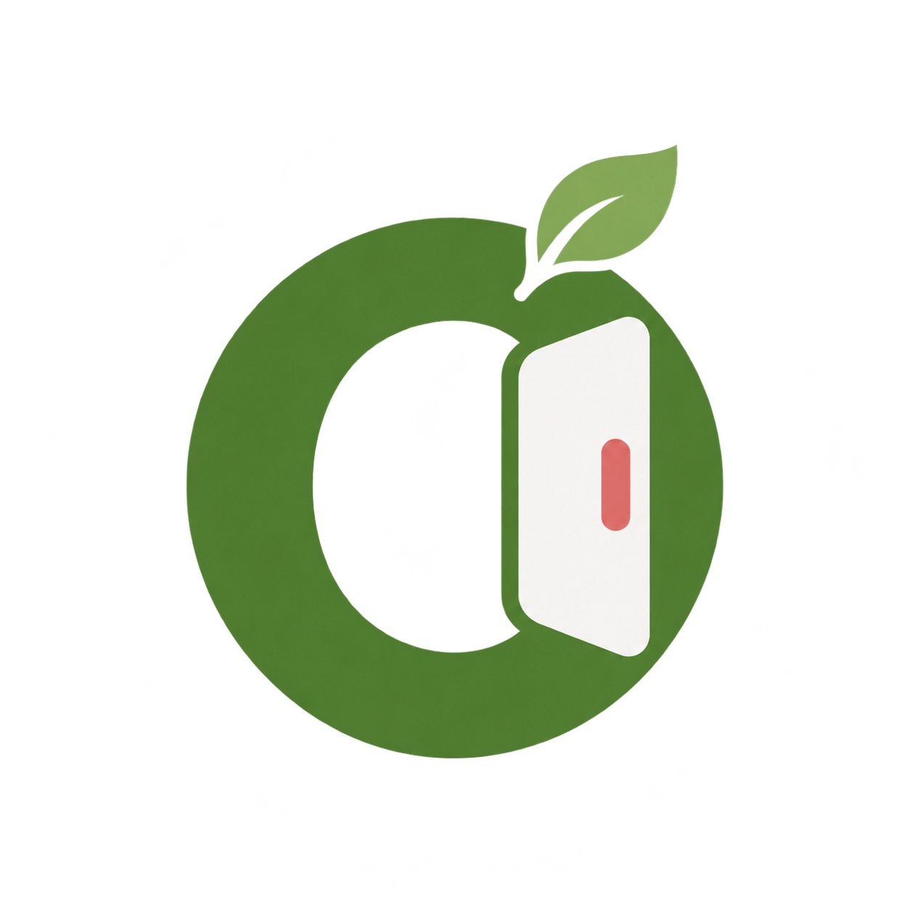
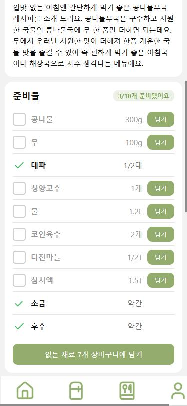
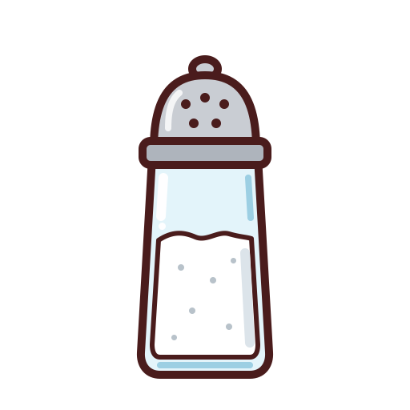
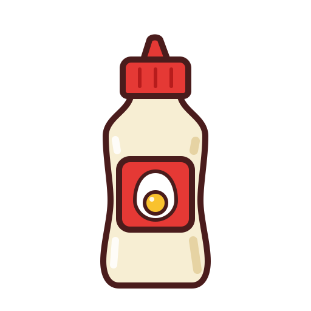
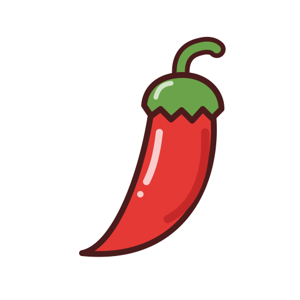

  
   
  

<h3 align="center">냉장고에 뭐가 남았는지 확인하고, 그 재료로 오늘 뭐 해 먹을지 고르는 서비스</h3>

  <a href="https://fridgeo.pages.dev">서비스 바로가기 (fridgeo.pages.dev)</a>
   
  2026.11.04 ~ 11.20 (17일), 4인 팀 프로젝트

---

## 팀원

| 황건영 | 성시원 | 김미래 | 홍순법 |
| :---: | :---: | :---: | :---: |
| **서버, DB, 배포** | **프로젝트 세팅, 냉장고** | **마이페이지, 재료 입력** | **레시피, 리뷰** |
| 메인 화면, 알림, 하단 메뉴 로그인/회원가입/문자 인증 북마크, 전체 페이지 DB 연동 데스크탑 화면 Hono 전환, 자동 배포 | React + Vite 초기 구조 냉장고 목록과 기한 표시 임박순 정렬, 편집, 삭제 | 마이페이지, 상단 헤더 재료 등록/편집 달력 프로필 사진 | 레시피 목록, 분류 아이콘 레시피 상세 페이지 리뷰 작성/수정/삭제 |

처음에는 각자 맡은 화면을 따로 만들었고, 11월 11일부터 서버를 붙이면서 하나의 데이터로 합쳤습니다.

---

## 어떤 서비스인가요?

자취를 하다 보면 냉장고에 뭘 넣어 뒀는지 잊어버려서 기한이 지난 뒤에 버리게 되는 일이 생깁니다. 반대로 재료는 있는데 뭘 만들어야 할지 몰라서 그냥 다른 걸 사 먹기도 합니다.

fridgeO는 이 두 가지를 한 번에 해결해 보려고 만든 웹 서비스입니다.

1. 냉장고에 재료를 등록하면
2. 기한이 얼마나 남았는지 홈에서 바로 보이고
3. 가지고 있는 재료로 만들 수 있는 레시피를 추천해 주고
4. 레시피를 열면 내가 가진 재료와 부족한 재료를 구분해서 보여 줍니다

주로 1인 가구나 자취생을 생각하고 만들었고, 휴대폰 화면을 기준으로 디자인한 뒤 데스크탑 화면도 따로 만들었습니다.

---

## 기술 스택

| 구분 | 사용한 기술 |
| --- | --- |
| **언어** |     |
| **프론트엔드** |     |
| **백엔드** |   |
| **DB** |   |
| **로그인** |   |
| **사진 저장** |  |
| **배포** |   |
| **AI 도구** |    |

화면은 Cloudflare Pages에, 서버는 Cloudflare Workers에 올라가 있습니다. main 브랜치에 push하면 GitHub Actions가 lint와 테스트를 돌린 뒤 자동으로 배포합니다.

화면 폭이 1024px 이상이면 데스크탑 화면을, 그보다 작으면 모바일 화면을 보여 줍니다. 화면 배치만 다르고 데이터를 불러오고 저장하는 코드는 같이 씁니다.

AI 도구는 기획을 정리하거나 코드를 작성하고 리뷰할 때, 문서를 정리할 때 함께 사용했습니다.

---

## 화면

### 모바일

| 홈 | 재료 등록 | 냉장고 | 레시피 준비물 |
| :---: | :---: | :---: | :---: |
|  |  |  |  |
| 기한이 임박했거나 지난 재료, 다 떨어진 재료를 모아서 보여 줌 | 재료 이름만 넣으면 유통기한을 알아서 채워 줌 | 기한이 급한 순서로 정렬, 5일 이하는 빨간색 | 가진 재료는 자동으로 체크, 없는 재료는 쇼핑 검색으로 |

### 데스크탑

| 대시보드 | 냉장고 |
| :---: | :---: |
|  |  |
| 급한 재료 목록, 이번 주 유통기한 달력, 추천 레시피 | 냉장/냉동/실온 칸으로 나뉘어 있고, 카드를 끌어다 놓으면 보관 장소가 바뀜 |

---

## 주요 기능

**냉장고**
- 재료 이름을 입력하면 자동완성이 뜨고, 재료마다 보통 보관 기간을 기준으로 유통기한을 미리 채워 줍니다. (예: 우유는 10일 뒤)
- 수량, 단위, 보관 장소(실온/냉장/냉동)를 저장할 수 있습니다.
- 다 먹은 재료는 지우지 않고 '다 떨어짐'으로 남겨 둘 수 있어서 장 볼 때 참고할 수 있습니다.
- 기한이 5일 이하로 남으면 알림이 옵니다.

**레시피**
- 냉장고에 있는 재료와 많이 겹치는 레시피부터 추천합니다.
- 레시피 상세에서 준비물마다 내가 가지고 있는지 표시하고, 없는 재료는 쿠팡 검색으로 바로 넘어갑니다.
- 카테고리별 목록, 통합 검색, 레시피 직접 작성도 됩니다.

**그 밖에**
- 별점과 리뷰, 북마크, 작성자 팔로우
- 마이페이지에서 내가 쓴 레시피, 북마크, 최근 본 레시피 확인
- 회원가입과 로그인, 휴대폰 문자 인증, 계정 찾기

### 만들면서 바꾼 것들

처음 버전에서는 화면을 먼저 만들다 보니 고정된 예시 데이터가 많이 남아 있었습니다. 서버를 붙인 뒤에 하나씩 실제 내 냉장고 데이터로 바꿨습니다.

- 유통기한 기본값이 재료와 상관없이 무조건 7일이었는데, 재료별 보관 기간으로 계산하도록 바꿨습니다.
- 레시피 준비물 체크가 예시 목록이라 누가 봐도 똑같이 체크돼 있었는데, 내 냉장고 기준으로 바꿨습니다.
- 수량을 0으로 저장할 수 없어서 다 먹으면 지워야 했는데, 0이면 '다 떨어짐'으로 남도록 했습니다.
- 홈의 조미료가 항상 같은 6개였는데, 내 냉장고에 있는 조미료만 보이게 바꿨습니다.

---

## 디자인

로고의 초록 사과에서 색을 가져왔습니다. 화면 대부분은 초록 계열로 맞추고, 빨간색은 기한이 임박했거나 삭제처럼 바로 봐야 하는 곳에만 썼습니다.

- 메인 초록 `#6F9C4C`: 버튼, 선택된 상태, 아이콘
- 진한 초록 `#4D7A2C`: 강조 글씨
- 연한 초록 `#CAE3A5`: 홈 상단 배경
- 빨강 `#C06563`: 임박한 기한, 삭제
- 회색 `#F2F2F2`: 배경, 카드

조미료는 아이콘을 따로 그려서 넣었습니다.

  
  
  
  
  
  

---

## 개발 과정

| 날짜 | 한 일 |
| --- | --- |
| 11.04 | 프로젝트 세팅 |
| 11.06 | 냉장고, 메인 화면 첫 버전 |
| 11.09 | 마이페이지, 레시피, 알림 화면 추가 후 각자 작업한 것 합치기 |
| 11.10 | 서버와 로그인 구축, 리뷰와 북마크 |
| 11.11 | 냉장고, 레시피 DB 연결 |
| 11.12 | 통합 검색, 레시피 작성, 재료 사전 |
| 11.13 | 조미료, 팔로우, 개인정보 변경 |
| 11.16 | 데스크탑 화면 추가 |
| 11.17 | 서버를 Hono로 옮기고 자동 배포 설정 |
| 11.20 | 개발 마무리 |

진행하면서 생긴 문제와 해결 방법은 트러블슈팅 문서에 정리해 두었습니다. 프론트엔드에서 39건, 서버에서 23건이 나왔습니다.

### 회고

- **같은 데이터를 화면마다 따로 불러오면 꼭 꼬인다.** 재료를 저장했는데 다른 화면에는 예전 값이 그대로 보이는 문제가 계속 생겼습니다. React Query로 데이터 불러오는 부분을 한곳에 모으고 나서야 해결됐습니다.
- **.env 파일은 정말 조심해야 한다.** DB 비밀번호가 들어 있는 파일을 실수로 GitHub에 올린 적이 있습니다. 그 뒤로는 커밋하기 전에 바뀐 파일을 꼭 확인합니다.
- **lint 결과는 끝까지 확인하자.** 출력 마지막 줄만 보고 통과한 줄 알았다가 오류를 놓친 적이 있습니다.
- **작업은 최신 main에서 시작하자.** 폴더 구조가 바뀐 걸 모르고 예전 코드에서 작업하다가 합칠 때 빌드가 깨졌습니다.

### 아쉬운 점과 다음에 할 것

- 레시피 추천이 재료 이름이 똑같아야만 연결됩니다. '대파'와 '파'처럼 이름이 조금만 달라도 다른 재료로 인식해서, 같은 재료로 묶는 작업이 필요합니다.
- 기획할 때 세운 사용자 불편은 저희끼리 생각한 가설이라, 실제 자취생들에게 물어보고 확인해 보고 싶습니다.

---

## 문서

- [기획안](docs/PROJECT_PLAN.md)
- [개발 일지](docs/DEVLOG.md)
- [프론트엔드 트러블슈팅](docs/TROUBLESHOOTING-frontend.md)
- [서버 트러블슈팅](docs/TROUBLESHOOTING-server.md)
- [DB 구조](docs/DB.md)
